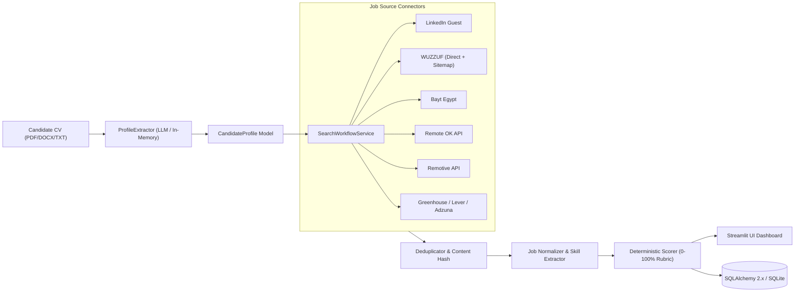

# 🚀 [Tips Hindawi](https://www.tipshindawi.com/) Internship (August–October) 2026

> 🎓 This project was built during the [ **Tips Hindawi** ](https://www.tipshindawi.com/) **Internship (August–October) 2026**.

## 👤 Participant

| Field            | Value                                |
| ---------------- | ------------------------------------ |
| Full Name        | Ahmed Tarek                          |
| Project Name     | Opportunity Radar 📡                 |
| GitHub Username  | Ahmed-Tarek0                         |
| Internship Batch | August–October 2026                  |
| Training Program | Large Language Models (LLMs) Program |
| Organization     | [**Edrak for Ai**](https://edrak4ai.com/en) |

---

# 🌐 Live Demo & Deployment

[](https://opportunity-radar-selector.streamlit.app/)

🔗 **Live Web Application:** [https://opportunity-radar-selector.streamlit.app/](https://opportunity-radar-selector.streamlit.app/)

---

# 📖 Project Overview

**Opportunity Radar** is an intelligent, privacy-centric job discovery and deterministic candidate-matching platform. It ingests software engineering and tech resumes across diverse formats (PDF, DOCX, TXT), accurately parses skills, career milestones, and target roles with grounded citations, queries real-time job feeds and ATS endpoints, and ranks opportunities using a transparent, multi-factor scoring rubric — all while respecting strict date integrity and candidate privacy boundaries.

Unlike opaque "black-box" job matching engines, Opportunity Radar provides full visibility into every score, highlighting matched skills, missing prerequisites, experience alignment, and direct evidence citations from both the CV and job listings.

---

# ✨ Features

* **🛡️ Privacy-First CV Ingestion**: Resumes are parsed in-memory and immediately discarded. Only a cryptographic SHA-256 fingerprint and the validated Pydantic model (`CandidateProfile`) are persisted. Zero raw CV text or PII is saved to disk or database.
* **🔍 Multi-Source Opportunity Aggregation**: Simultaneously queries real-time regional and global job feeds:
  * **LinkedIn** (Public Guest Search)
  * **WUZZUF** (Egypt regional hub with sitemap resilience fallback)
  * **Bayt Egypt** (Regional opportunities connector)
  * **Remote OK** & **Remotive** (Worldwide remote tech feeds)
  * **Greenhouse & Lever ATS** (Direct company job boards)
  * **Adzuna** (Comprehensive job index API)
* **⚖️ Explainable Multi-Factor Scoring Rubric (0–100%)**:
  * **50% Skill Alignment**: Mandatory vs. preferred skills matching with domain implication graphs (e.g., PyTorch implies Deep Learning/AI).
  * **25% Role & Title Relevance**: Domain-aware title alignment with strict false-positive filtering for unrelated engineering fields.
  * **25% Experience & Seniority Fit**: Seniority level compatibility matrix and years-of-experience calibration.
  * **Location & Work Arrangement**: Handled as an eligibility gate / filter rather than inflating match scores artificially.
* **📅 Absolute Date Integrity**: Records only verified original `posted_at` timestamps. It never substitutes fetch dates for posting dates.
* **🚦 Isolated Failure Architecture & Graceful Degradation**: Sources operate as independent workers. If one source faces anti-bot challenges or timeouts, other sources complete without interruption.
* **💾 Saved Jobs & Export**: Bookmark opportunities, manage application pipelines with persistent storage across browser refreshes, and export curated results directly to CSV.

---

# 🛠️ Technologies Used

### Core & Backend
* **Python 3.11+**
* **Pydantic v2 & Pydantic-Settings**: Strict schema validation and configuration management.
* **SQLAlchemy 2.x & Alembic**: Relational data modeling, query engine, and schema migrations.
* **SQLite**: Fast, self-contained relational database (PostgreSQL compatible).

### Extraction & NLP / LLM
* **PyMuPDF (fitz) & python-docx**: Accurate multi-format resume document parsing.
* **Google Gemini API (`google-genai`) & OpenAI API (`openai`)**: LLM provider abstractions for structured profile extraction and explanation generation.
* **RapidFuzz**: High-performance fuzzy string and keyword matching.

### Networking & Web Scraping
* **HTTPX**: High-performance asynchronous and pooled HTTP client with browser emulation.
* **BeautifulSoup4 & lxml**: Resilient HTML scraping and XML sitemap parsing.

### Frontend
* **Streamlit**: Responsive, multipage interactive web dashboard with custom styled components and status indicators.

### Testing & Code Quality
* **Pytest & Respx**: Unit testing suite with mock HTTP interactions (60 passed tests).
* **Ruff**: Modern fast linting and formatting.

---

# 🏗️ System Architecture



---

# ⚙️ Installation

### 1. Prerequisites
* Python 3.11+
* Git

### 2. Clone Repository & Setup Environment
```bash
# Clone the repository
git clone https://github.com/Ahmed-Tarek0/opportunity-radar.git
cd opportunity-radar

# Create virtual environment
python -m venv .venv

# Activate virtual environment
# Windows (PowerShell):
.\.venv\Scripts\Activate.ps1
# Windows (CMD):
.\.venv\Scripts\activate.bat
# Linux / macOS:
source .venv/bin/activate

# Install dependencies in editable mode
pip install -r requirements.txt
# Or for development dependencies:
pip install -e ".[dev]"
```

### 3. Environment Configuration
Copy the sample environment file:
```bash
cp .env.example .env
```
Fill in your optional API keys in `.env`:
```env
APP_ENV=development
DEMO_MODE=false
DEFAULT_TIMEZONE=Africa/Cairo
DATABASE_URL=sqlite:///./data/opportunity_radar.db

# LLM Provider Configuration (Gemini or OpenAI)
LLM_PROVIDER=gemini
GEMINI_API_KEY=your_gemini_api_key_here
GEMINI_MODEL=gemini-2.0-flash
```

### 4. Initialize Database
```bash
python scripts/init_db.py
```

---

# 🚀 Usage

### Run the Web Application
```bash
streamlit run app.py
```
Open your browser at `http://localhost:8501` or visit the [Live Deployment](https://opportunity-radar-selector.streamlit.app/).

### User Flow:
1. **Upload CV (`Profile` Page)**: Upload your CV (PDF, DOCX, or TXT). The system extracts your skills, experience, and target roles in-memory.
2. **Discover Jobs (`Discover Jobs` Page)**:
   - Select your lookback window (1 Week, 2 Weeks, 3 Weeks, 1 Month).
   - Click **Find Jobs** to trigger parallel queries across all enabled live sources.
3. **Inspect Match Details**: Review detailed scores, evidence citations, matched vs. missing skills, and direct apply links.
4. **Save & Export (`Saved Jobs` Page)**: Bookmark opportunities, add notes, and export to CSV.

---

# 📈 Results & Key Outcomes

* **100% Deterministic & Explainable Scoring**: Eliminated hallucinated scores and false positives from non-software engineering domains.
* **Extensible Architecture**: Modular adapters make it seamless to integrate new job boards and ATS APIs without altering core domain logic.
* **Rock-Solid Test Coverage**: 60 automated unit tests verifying matching logic, normalizers, deduplication, and schema validation.
* **Resilient Scraping**: Automated fallback mechanisms (e.g., sitemap parsing) ensure continuous job retrieval even under anti-bot challenges.

---

# 🔮 Future Improvements

* [ ] Add automated email/Telegram alerts for newly matched jobs scoring above a user-defined threshold.
* [ ] Support vector embeddings with hybrid search (BM25 + Semantic) for complex job descriptions.
* [ ] Add cover letter and tailored resume suggestion generation based on matched gaps.
* [ ] Add direct OAuth application tracking integrations with popular job portals.

---

# 📚 About the Internship

This project was developed as part of the [**Tips Hindawi**](https://www.tipshindawi.com/) **Internship (August–October) 2026**, and it will be showcased on the official [Tips Hindawi](https://www.tipshindawi.com/) website.

[Tips Hindawi](https://www.tipshindawi.com/) is the internships department of [**Edrak for Ai**](https://edrak4ai.com/en), and the internship encourages participants to build real-world projects, apply practical skills, and showcase their work through GitHub.

For more information about the internship, training programs, and upcoming batches, visit the official [Tips Hindawi](https://www.tipshindawi.com/) website.

---

# 📄 License

This project is shared for educational and portfolio purposes under the MIT License.
