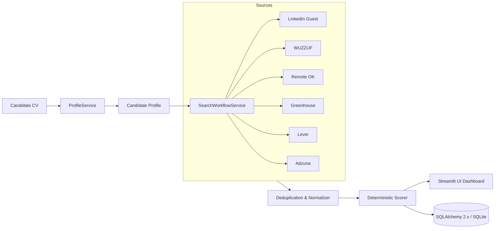

# Opportunity Radar 📡

> **Intelligent, privacy-centric job discovery & deterministic candidate matching platform.**

[](https://www.python.org/)
[](https://streamlit.io/)
[](https://docs.pydantic.dev/)
[](https://www.sqlalchemy.org/)
[](LICENSE)

Opportunity Radar ingests your engineering CV (PDF, DOCX, TXT), extracts verifiable skills and career milestones with grounded citations, queries real-time job feeds and ATS endpoints, and ranks opportunities using a transparent, deterministic matching rubric — all while respecting strict date integrity and candidate privacy.

---

## 🌟 Key Features

- **🛡️ Strict Privacy-First Ingestion**:
  Raw resumes are parsed in-memory and immediately discarded. Only a cryptographic SHA-256 fingerprint and the structured candidate profile are persisted. No raw CV text or PII is stored.
- **🔍 Multi-Source Opportunity Aggregation**:
  Query LinkedIn (Public Guest Search), WUZZUF (Egypt regional hub), Remote OK (Worldwide Remote API), Greenhouse ATS, Lever ATS, and Adzuna simultaneously.
- **⚖️ Deterministic Multi-Factor Scoring**:
  No black-box hallucinations. Match scores ($0 - 100$) are calculated using an explainable rubric:
  - **40% Skills Alignment** (Mandatory vs. Preferred overlaps)
  - **25% Experience Fit** (Years of experience and seniority calibration)
  - **20% Role Relevance** (Target job title semantic overlap)
  - **15% Work Arrangement & Location** (Remote eligibility and location match)
- **📅 Absolute Date Integrity**:
  The radar strictly records verified `posted_at` timestamps. It never substitutes `fetched_at` or `first_seen_at` for job dates. Timestamps are stored in UTC and rendered in `Africa/Cairo` time.
- **🚦 Isolated Failure Architecture**:
  Sources operate independently. If LinkedIn or WUZZUF encounter anti-bot defenses or network timeouts, other sources proceed uninterrupted.
- **💾 Saved Jobs & Export**:
  Bookmark interesting opportunities, add application notes, and export your curated pipeline directly to CSV.

---

## 🏗️ Architecture & Tech Stack



- **Frontend**: Streamlit (Multipage architecture)
- **Data Validation**: Pydantic v2
- **Persistence**: SQLAlchemy 2.x + SQLite (PostgreSQL compatible)
- **HTTP Engine**: `httpx` with connection pooling
- **Document Extractors**: `PyMuPDF` (PDF) + `python-docx` (DOCX)
- **String & Semantic Matching**: `rapidfuzz` + optional Gemini / OpenAI embeddings

---

## 🚀 Quick Start

### 1. Prerequisites
- Python 3.11 or higher
- Git

### 2. Clone and Setup Environment
```bash
# Clone repository
git clone https://github.com/your-org/opportunity-radar.git
cd opportunity-radar

# Create virtual environment
python -m venv .venv

# Activate virtual environment
# On Windows PowerShell:
.\.venv\Scripts\Activate.ps1
# On Linux / macOS:
source .venv/bin/activate

# Install dependencies
pip install -e ".[dev]"
```

### 3. Configure Environment Variables
Copy `.env.example` to `.env`:
```bash
cp .env.example .env
```
Key configuration settings:
```ini
APP_ENV=development
DEMO_MODE=true
DEFAULT_TIMEZONE=Africa/Cairo
DATABASE_URL=sqlite:///./data/opportunity_radar.db

# Optional LLM providers for enhanced extraction
LLM_PROVIDER=gemini
GEMINI_API_KEY=your_gemini_api_key_here
```

### 4. Initialize Database & Seed Demo Data
```bash
python scripts/init_db.py
python scripts/seed_demo_data.py
```

### 5. Launch the Application
```bash
streamlit run app.py
```
Open your browser at `http://localhost:8501`.

---

## 🧪 Demo Mode vs. Live Mode

- **Demo Mode (`DEMO_MODE=true`)**:
  Pre-loaded with synthetic job listings (`data/demo_jobs.json`) and a sample Senior Python Backend Engineer profile. Perfect for evaluation, offline testing, and UI exploration without external network calls. All demo jobs are explicitly watermarked with `is_demo=True`.
- **Live Mode (`DEMO_MODE=false`)**:
  Connects to configured live adapters. Ingests your personal resume, queries live endpoints, filters for real-time postings, and saves matches to your local database.

---

## 🔌 Source Configuration Guide

| Source | Setup Requirement | How to Enable |
| :--- | :--- | :--- |
| **LinkedIn** | None (uses public guest endpoints) | `ENABLE_LINKEDIN_SOURCE=true` |
| **WUZZUF** | None (public Egypt search feeds) | `ENABLE_WUZZUF_SOURCE=true` |
| **Remote OK** | None (public JSON API) | `ENABLE_REMOTEOK_SOURCE=true` |
| **Greenhouse** | Set company slugs in `.env` | `ENABLE_GREENHOUSE_SOURCE=true`<br>`GREENHOUSE_BOARD_SLUGS=canonical,gitlab` |
| **Lever** | Set company slugs in `.env` | `ENABLE_LEVER_SOURCE=true`<br>`LEVER_COMPANY_SLUGS=palantir,netflix` |
| **Adzuna** | Register developer keys | `ENABLE_ADZUNA_SOURCE=true`<br>`ADZUNA_APP_ID=xxx`<br>`ADZUNA_APP_KEY=yyy` |

To verify source status and network connectivity from the CLI:
```bash
python scripts/check_sources.py
```

---

## 🛠️ Testing & Linting

```bash
# Run unit and integration tests
python -m pytest tests/ -v

# Run code style and linting checks
ruff check src tests
ruff format --check src tests
```

---

## ⚖️ Limitations & Ethical Scraping Disclaimer

Opportunity Radar accesses public guest endpoints, official public APIs, and ATS board listings strictly for personal job search assistance. It does not bypass authentication paywalls, CAPTCHAs, or private user boundaries. Please respect the respective platforms' Terms of Service and adhere to fair use request rates.
