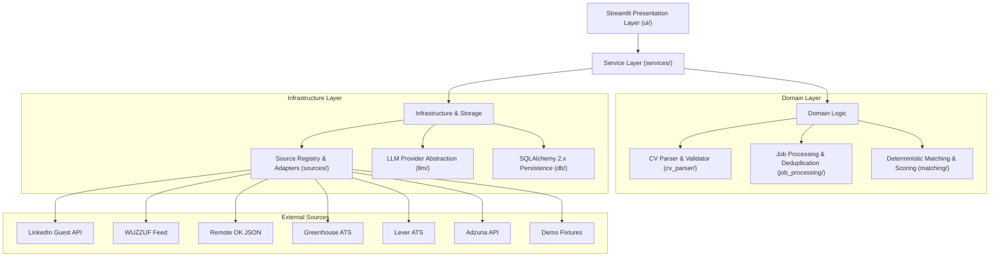
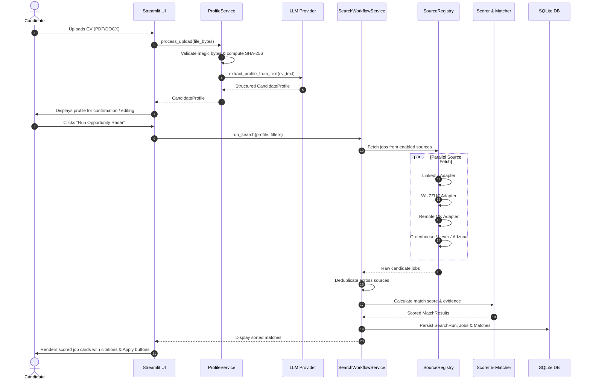

# Architecture: Opportunity Radar

## 1. System Overview

Opportunity Radar is designed as a **modular monolith** adhering to hexagonal and clean architecture principles. It separates presentation concerns (Streamlit), application workflow coordination (Services), domain processing rules (Matching, Job Processing, CV Extraction), and external infrastructure adapters (Database, LLM Providers, Source Adapters).

---

## 2. Layer Breakdown

### 2.1 Presentation Layer (`ui/`)
- **Technology**: Streamlit Multipage Framework with custom CSS styling and responsive layouts.
- **Components**:
  - `home.py`: Candidate entry point, CV file dropzone, processing status.
  - `profile.py`: Visual candidate profile confirmation, skill badge editor, preferences adjustment.
  - `discover_jobs.py`: Primary job radar board with multi-attribute filtering, score meters, and match citation cards.
  - `saved_jobs.py`: Bookmark drawer with application notes and CSV export capability.
  - `source_status.py`: Real-time health diagnostic dashboard displaying adapter connectivity and response metrics.
- **State Management**: Encapsulated in `ui/state.py` using `st.session_state` with immutable fallback profiles.

### 2.2 Service Layer (`services/`)
- **`ProfileService`**:
  - Manages CV file validation (size, MIME, magic bytes, SHA-256 computation).
  - Coordinates text extraction (`PyMuPDF` / `python-docx`).
  - Calls structured LLM extraction or fallback heuristic extraction.
  - Persists profiles and provides synthetic demo profiles.
- **`SearchWorkflowService`**:
  - Orchestrates multi-source queries generated by `matching/query_generator.py`.
  - Runs sources independently with error boundaries (partial failure isolation).
  - Normalizes fields and deduplicates job records.
  - Calculates deterministic multi-factor match scores against the active profile.
  - Writes execution summaries to `SearchRunModel` and `SourceRunLogModel`.

### 2.3 Domain Processing
- **`cv_parser/`**:
  - `file_validation.py`: Strict validation against malicious extensions or oversized files.
  - `text_extractor.py`: Extracts raw character streams from documents while preserving paragraph structure.
  - `profile_extractor.py`: Transforms raw CV text into structured `CandidateProfile` instances with evidence citations.
- **`job_processing/`**:
  - `normalizer.py`: Infers employment type, seniority level, and standardized work mode (`remote`, `hybrid`, `on_site`).
  - `location_rules.py`: Determines remote eligibility and Egyptian territory compliance.
  - `freshness.py`: Normalizes dates to UTC and provides Cairo timezone formatting (`Africa/Cairo`).
  - `deduplicator.py`: Combines URL canonicalization and rapid fuzzy matching on `(normalized_title, normalized_company)` to eliminate duplicates across platforms.
- **`matching/`**:
  - `skill_normalizer.py`: Maps skill variations to standard canonical names (e.g., `FastAPI` $\rightarrow$ `fastapi`).
  - `scorer.py`: Computes composite compatibility score based on four weighted pillars:
    - **Skills Alignment**: 40% (required vs. preferred skills)
    - **Experience Alignment**: 25% (years of experience & seniority fit)
    - **Title Alignment**: 20% (role title similarity)
    - **Work Arrangement & Location**: 15% (remote/hybrid/location preference)
  - `query_generator.py`: Extracts optimal search keywords from candidate target titles and primary skills.

### 2.4 Source Adapters (`sources/`)
- **`JobSource` Base Contract**:
  - Provides uniform methods: `is_configured()`, `is_enabled()`, `health_check()`, and `fetch_jobs()`.
- **`SourceRegistry`**:
  - Central discovery container for adapters.
  - Iterates through enabled and configured sources without tight coupling.
- **Supported Adapters**:
  1. `demo`: Local fixtures loaded from `data/demo_jobs.json`.
  2. `linkedin`: Public guest endpoint for recent job cards.
  3. `wuzzuf`: Egypt-focused job listing parser.
  4. `remoteok`: Public JSON API for worldwide tech listings.
  5. `greenhouse`: ATS Job Board API v1 for configured organization boards.
  6. `lever`: ATS Postings API v0 for configured company instances.
  7. `adzuna`: REST API integration with developer credentials.

### 2.5 LLM Abstraction (`llm/`)
- **`BaseLLMProvider`**:
  - Common interface providing `generate_json()`, `generate_text()`, and `get_embedding()`.
- **`GeminiProvider`**:
  - Integrates `google-genai` using `gemini-2.0-flash` and `gemini-embedding-001`.
- **`OpenAIProvider`**:
  - Integrates `openai` using `gpt-4o-mini` and `text-embedding-3-small`.
- **Provider Factory (`create_llm_provider()`)**:
  - Dynamically binds the configured provider from environment variables.
  - Implements automatic JSON parsing cleanup and fallback heuristics.

### 2.6 Persistence Layer (`db/`)
- **ORM**: SQLAlchemy 2.x declarative mapped models.
- **Database Engine**: SQLite with zero external dependencies by default; PostgreSQL ready via configuration string.
- **Models**:
  - `CandidateProfileModel`: Stores parsed candidate profile JSON, file hash, and creation timestamps.
  - `JobModel`: Stores canonical job listings, work mode, salary details, and source provenance.
  - `JobMatchModel`: Persists calculated match score, breakdown percentages, and evidence snippets.
  - `SavedJobModel`: Candidate bookmarks, application status, and personal notes.
  - `SearchRunModel`: Audit trail of search executions.
  - `SourceRunLogModel`: Detailed telemetry and diagnostics for each source run.
  - `EmbeddingCacheModel`: Caches text embeddings to prevent redundant LLM API calls.

---

## 3. Step-by-Step Primary User Journey

---

## 4. Security, Privacy, and Data Governance

1. **CV Privacy & Ephemeral Processing**:
   - Resumes contain highly sensitive PII. Opportunity Radar **never stores raw CV documents, binary bytes, or raw extracted text** in any database table or static log file.
   - Only derived, structured attributes and the document's SHA-256 checksum are stored.
2. **Prompt Injection Hardening**:
   - User-supplied CV text is treated as an untrusted payload. System prompts strictly delineate user content using XML tags (`<cv_content>...</cv_content>`) and issue instructions forbidding prompt leakage or command execution.
3. **URL Validation & SSRF Prevention**:
   - All inbound external application and job URLs are validated against strict HTTP/HTTPS schemes before rendering clickable links in the UI.
4. **Credential Isolation**:
   - API keys and tokens are loaded strictly via environment variables or `.env` files via Pydantic Settings. No secrets are committed to version control or written to execution logs.
