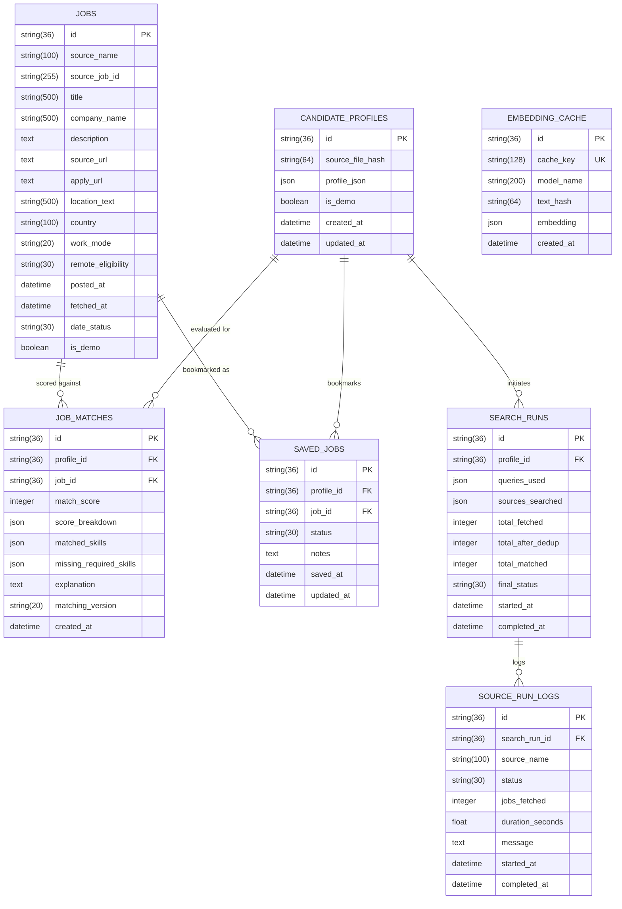

# Data Model Specification: Opportunity Radar

This document details the core Pydantic v2 domain schemas, the relational SQLAlchemy 2.x persistence models, and field validation constraints.

---

## 1. Domain Schemas (Pydantic v2)

### 1.1 CandidateProfile (`opportunity_radar.schemas.profile`)

Represents the structured interpretation of an ingested resume.

| Field | Type | Description |
| :--- | :--- | :--- |
| `id` | `UUID` | Unique identifier (auto-generated). |
| `source_file_hash` | `str \| None` | SHA-256 hex digest of the raw uploaded document. |
| `full_name` | `str \| None` | Candidate full name (if extracted). |
| `headline` | `str \| None` | Professional title or headline summary. |
| `summary` | `str \| None` | Extracted or synthesized candidate summary. |
| `skills` | `list[Skill]` | List of extracted technical and soft skills with evidence. |
| `experiences` | `list[WorkExperience]` | Career history items with descriptions and technologies. |
| `projects` | `list[Project]` | Open-source or portfolio projects. |
| `education` | `list[Education]` | Degrees, institutions, and graduation years. |
| `certifications` | `list[Certification]` | Professional certificates and issuing bodies. |
| `target_titles` | `list[TargetTitle]` | Suggested or candidate-curated target job titles. |
| `seniority_estimate` | `SeniorityLevel` | Estimated career level: `junior`, `mid`, `senior`, `lead`, `executive`. |
| `years_experience_estimate` | `float` | Estimated cumulative years of relevant professional experience. |
| `location_preference` | `LocationPreference` | Geographic rules (`include_egypt`, `include_worldwide_remote`, etc.). |
| `employment_preferences` | `EmploymentPreferences` | Preferences for `full_time`, `part_time`, `contract`, `remote`, `hybrid`. |
| `profile_confidence` | `float` | Overall extraction confidence score ($0.0 - 1.0$). |
| `fields_needing_confirmation` | `list[str]` | List of ambiguous fields flagged for candidate review. |
| `is_demo` | `bool` | Flag set to `True` for fixture/demo profiles. |
| `created_at` | `datetime` | UTC timestamp of profile creation. |
| `updated_at` | `datetime` | UTC timestamp of last update. |

#### Supporting Sub-Models
- **`Skill`**:
  - `name`: Normalized lowercase skill identifier (e.g. `fastapi`).
  - `original`: Original text representation (e.g. `FastAPI`).
  - `category`: Skill domain category (e.g. `backend`, `cloud`, `database`).
  - `evidence_snippet`: Verifiable excerpt extracted from the CV.
  - `evidence_type`: `explicit` | `project` | `experience` | `inferred`.
  - `confidence`: Extraction confidence score ($0.0 - 1.0$).
- **`WorkExperience`**:
  - `title`, `employer`, `start_date`, `end_date`, `description`, `technologies`, `evidence`.

---

### 1.2 NormalizedJob (`opportunity_radar.schemas.job`)

Standardized representation of a job posting harvested from any source.

| Field | Type | Description |
| :--- | :--- | :--- |
| `id` | `UUID` | Unique job identifier. |
| `source_name` | `str` | Originating adapter name (`linkedin`, `wuzzuf`, `remoteok`, etc.). |
| `source_job_id` | `str \| None` | Identifier provided by the upstream source. |
| `title` | `str` | Job title. |
| `company_name` | `str` | Hiring employer name. |
| `description` | `str \| None` | Job overview and role responsibilities. |
| `source_url` | `str \| None` | Direct link to the listing. |
| `apply_url` | `str \| None` | Application submission URL. |
| `location_text` | `str \| None` | Raw textual location string. |
| `country` | `str \| None` | Canonical country name (e.g. `Egypt`). |
| `city` | `str \| None` | Identified city name (e.g. `Cairo`). |
| `work_mode` | `WorkMode` | `remote` \| `hybrid` \| `on_site` \| `unknown`. |
| `remote_eligibility` | `RemoteEligibility` | `worldwide` \| `egypt_only` \| `emea` \| `country_specific` \| `no_remote` \| `unknown`. |
| `employment_type` | `EmploymentType` | `full_time` \| `part_time` \| `contract` \| `internship` \| `unknown`. |
| `seniority_level` | `SeniorityLevel` | `junior` \| `mid` \| `senior` \| `lead` \| `executive` \| `unknown`. |
| `required_skills` | `list[str]` | Mandatory technical skills. |
| `preferred_skills` | `list[str]` | Nice-to-have technical skills. |
| `responsibilities` | `list[str]` | Key duties. |
| `minimum_experience_years` | `float \| None` | Minimum required experience in years. |
| `salary_min` / `salary_max` | `float \| None` | Disclosed compensation boundaries. |
| `salary_currency` | `str \| None` | ISO currency code (e.g. `USD`, `EGP`). |
| `posted_at` | `datetime \| None` | Verified posting datetime in UTC. |
| `first_seen_at` | `datetime` | Timestamp when first retrieved by the radar. |
| `last_seen_at` | `datetime` | Timestamp when last confirmed active. |
| `fetched_at` | `datetime` | Fetch timestamp. |
| `date_status` | `DateStatus` | `exact` \| `relative` \| `estimated` \| `unknown`. |
| `content_hash` | `str \| None` | Content fingerprint for duplicate detection. |
| `canonical_url` | `str \| None` | Cleaned URL stripped of tracking parameters. |
| `raw_metadata` | `dict` | Additional unstructured payload from the source. |
| `is_demo` | `bool` | True if originating from demo fixture data. |

---

### 1.3 MatchResult (`opportunity_radar.schemas.matching`)

Deterministic score evaluation comparing a `CandidateProfile` against a `NormalizedJob`.

| Field | Type | Description |
| :--- | :--- | :--- |
| `job_id` | `UUID` | Targeted job identifier. |
| `profile_id` | `UUID` | Matched candidate profile identifier. |
| `match_score` | `int` | Composite score normalized between $0$ and $100$. |
| `score_breakdown` | `list[ScoreComponent]` | Four explicit scoring pillars with point allocations. |
| `matched_skills` | `list[str]` | Overlapping skills between candidate and job requirements. |
| `missing_required_skills`| `list[str]` | Mandatory job skills absent from candidate profile. |
| `missing_preferred_skills`| `list[str]`| Desired skills absent from candidate profile. |
| `uncertain_requirements` | `list[str]` | Requirements needing candidate clarification. |
| `experience_alignment` | `str` | Qualitative analysis of candidate vs. required years. |
| `title_alignment` | `str` | Semantic comparison between target titles and job title. |
| `work_location_alignment`| `str` | Analysis of remote eligibility and candidate preferences. |
| `eligibility_status` | `EligibilityStatus` | `eligible` \| `uncertain` \| `ineligible`. |
| `eligibility_reasons` | `list[str]` | Detailed justifications for eligibility classification. |
| `evidence_citations` | `list[EvidenceCitation]`| Direct CV and job quotes supporting the score. |
| `explanation` | `str` | Human-readable explanation of fit. |
| `suggested_next_action` | `str` | Tactical recommendation (e.g., "Highlight FastAPI experience"). |
| `matching_version` | `str` | Algorithmic rubric version (e.g. `1.0.0`). |
| `used_semantic_matching`| `bool` | Indicates whether embedding vector similarity was used. |
| `used_llm_explanation` | `bool` | Indicates whether an LLM was invoked to generate narrative text. |
| `fallback_used` | `bool` | Indicates whether heuristic fallback scoring was triggered. |

#### Scoring Weight Composition
$$\text{Total Score} = (S_{\text{skills}} \times 0.40) + (S_{\text{experience}} \times 0.25) + (S_{\text{title}} \times 0.20) + (S_{\text{work\_arrangement}} \times 0.15)$$

---

## 2. Relational Database Tables (SQLAlchemy 2.x)

---

## 3. Database Engine Differences: SQLite vs. PostgreSQL

| Behavior | SQLite Implementation | PostgreSQL Implementation |
| :--- | :--- | :--- |
| **DateTime Storage** | Stored as ISO 8601 text strings (`YYYY-MM-DDTHH:MM:SS.ffffff+00:00`). | Native `TIMESTAMP WITH TIME ZONE` (`TIMESTAMPTZ`). |
| **JSON Storage** | JSON1 extension storing JSON text with path queries. | Binary `JSONB` data type with GIN index support. |
| **UUID Primary Keys**| 36-character hyphenated UUID strings (`String(36)`). | Native 128-bit `UUID` type. |
| **Concurrency** | File locking (WAL mode recommended for concurrent reads).| Multi-Version Concurrency Control (MVCC) with row-level locking. |
| **Array Types** | Serialized as standard `JSON` lists. | Native `ARRAY` column types or `JSONB`. |
